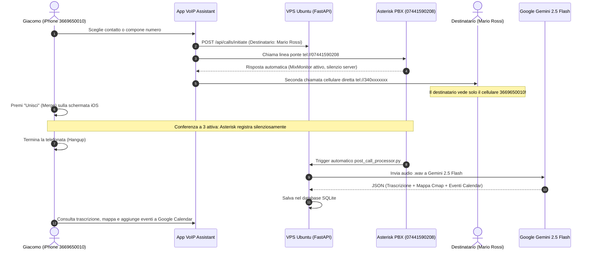

# VoIP Assistant (iOS + Asterisk PBX + Gemini 2.5 Flash)

Sistema completo di registrazione chiamate VoIP con **triangolazione inversa**, trascrizione avanzata tramite **Google Gemini 2.5 Flash**, generazione di **mappe concettuali interattive stile CmapTools** ed estrazione automatica di appuntamenti per **Google Calendar**.

---

## 📱 Architettura & Flusso di Chiamata ("Triangolazione Inversa")

Su iOS, a causa dei vincoli di sandbox e privacy, le app di terze parti non possono registrare direttamente le telefonate GSM in corso. Questo sistema risolve il problema garantendo che:
1. **Il destinatario visualizza ESCLUSIVAMENTE il tuo numero cellulare reale (`3669650010`)**.
2. **Il numero VoIP ponte (`07441590208`) rimane completamente invisibile** al destinatario.
3. Entrambe le voci vengono registrate in qualità cristallina da Asterisk PBX sulla VPS.

### Diagramma del Flusso



---

## 🛠️ Componenti del Progetto

### 1. App Nativa iOS (SwiftUI - iOS 16+)
- **Tab 1: Dialer & Rubrica**:
  - Integrazione nativa rubrica iOS (`ContactsUI` / `CNContactPickerViewController`).
  - Tastierino numerico rapido con feedback aptico.
  - Avvio automatico con guida visuale per unire le chiamate ("Merge").
- **Tab 2: Archivio & Mappe**:
  - Lista chiamate con filtri e ricerca testuale.
  - Player audio integrato (`AVPlayer`) per riascoltare la registrazione.
  - **Trascrizione fedele**: con separazione interlocutori, tasto copia e `ShareLink`.
  - **Mappa Concettuale (Stile CmapTools)**: renderizzata tramite `WKWebView` (Cytoscape.js) con nodi concettuali Novak, archi con parole legame, zoom, pan, drag ed esportazione immediata in PNG.
  - **Appuntamenti Rilevati**: card per ogni evento con titolo, orari e pulsante **"Aggiungi a Google Calendar"** precompilato.
- **Tab 3: Impostazioni**:
  - Parametri salvati in `@AppStorage` (URL VPS, Bearer Token, Numero Ponte, Cellulare Reale).
  - Test di connettività in tempo reale verso la VPS.

### 2. Backend VPS (Asterisk + FastAPI + Gemini AI)
- **`server/pjsip.conf`**: Configurazione PJSIP per trunk Ehiweb VivaVox (`07441590208`, `sip.vivavox.it`, porta UDP 5060, codec `g729,alaw,ulaw`).
- **`server/extensions.conf`**: Dialplan con risposta automatica, `MixMonitor` audio in alta fedeltà, silenziamento del canale server e hangup handler.
- **`server/processor.py`**: Interfaccia con **Google Gemini 2.5 Flash** (Structured Outputs JSON) per estrarre trascrizione, mappa concettuale ed eventi.
- **`server/post_call_processor.py`**: Script richiamato al termine della chiamata per collegare la registrazione alla sessione creata dall'app.
- **`server/main.py`**: API REST FastAPI protette da Bearer Token per app iOS.
- **`server/install.sh`**: Installer bash per Ubuntu 22.04 / 24.04 (configura Asterisk, Python, UFW e systemd).

### 3. CI/CD GitHub Actions (.ipa Unsigned)
- Compilazione automatica su `macos-14` tramite `xcodegen` e `xcodebuild` (`CODE_SIGNING_ALLOWED=NO`).
- Confezionamento del file `.ipa` in cartella `Payload`.
- Pubblicazione automatica della GitHub Release (`VoIPAssistant.ipa`) e degli Artifact di build per sideloading senza account Apple Developer a pagamento (AltStore, SideStore, TrollStore, Scarlet).

---

## 🚀 Guida di Avvio Rapido

### Passo 1: Configurazione VPS Ubuntu
Collegati alla tua VPS ed esegui l'installer:
```bash
git clone https://github.com/GiacomoTorrigiani/VOIP.git /tmp/voip-repo
cd /tmp/voip-repo/server
sudo bash install.sh
```

Verifica lo stato della registrazione VivaVox:
```bash
asterisk -rx "pjsip show registrations"
```

Verifica il backend:
```bash
curl http://localhost:8000/api/health
```

### Passo 2: Download & Installazione App su iPhone
1. Vai su GitHub alla sezione [Releases](https://github.com/GiacomoTorrigiani/VOIP/releases).
2. Scarica `VoIPAssistant.ipa`.
3. Installalo su iPhone tramite **AltStore**, **SideStore** o **TrollStore**.
4. Apri l'app, vai su **Impostazioni**, inserisci l'indirizzo IP della tua VPS (es. `http://194.164.175.69:8000`) e premi **"Verifica Connessione VPS"**.

---

## 🔒 Sicurezza & Parametri Predefiniti
- **Numero Ponte VoIP**: `07441590208`
- **Cellulare Reale Chiamante**: `3669650010`
- **Host SIP Ehiweb**: `sip.vivavox.it` (UDP 5060)
- **Modello AI**: `gemini-2.5-flash`
- **Secret Token API**: `TorriflixVoip2026SecureKey!` (modificabile da `.env` e impostazioni app)
